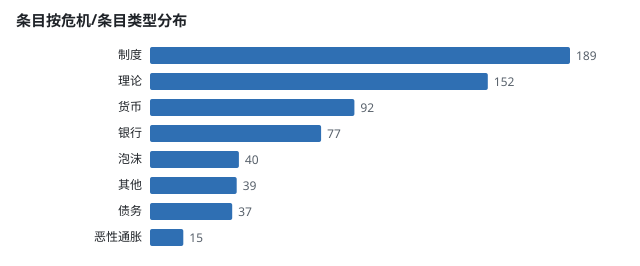
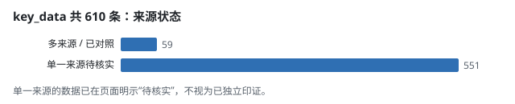

# 经济史与金融危机案例库

一个**数据驱动、机器校验、诚实标注**的静态知识库网站，按「时期 × 地区 × 危机类型」组织
**641 个**案例与理论制度条目（案例 209 / 概念 432），图表全为内联 SVG，浅/深双模式可读，零 JS、零图片。

## 当前规模

| 项 | 数值 |
|---|---|
| 条目 | **641**（案例 209 / 概念 432） |
| 来源库 | **742**（全部 verified） |
| key_data | **675** 条（按“本行 sources 少于 2 个”统一计数：653 条只有 1 个来源，其中 568 条来自维基、65 条来自 IMF 数据库、20 条来自 OWID/机构；页面明示“待核实”） |
| 站点页面 | **655**（14 静态页 + 641 条目页） |


## 可视化

图表由 `python -X utf8 tools/gen_stats.py` 从 `data/` 自动生成（内联 SVG，浅/深双模式），完整总览见 [docs/dashboard.html](docs/dashboard.html)。







## 目录结构

```
.
├── scope.md              范围清单（权威大纲取并集）
├── coverage.json         覆盖数据（层级/单元/地区/类型/来源）
├── COVERAGE_MATRIX.md    覆盖矩阵（时期×类型、时期×地区、地区×类型 + 空白清单）
├── DECISIONS.md          无人值守决策记录
├── PROGRESS.md           进度与续跑起点（逐轮记录）
├── REPORT.md             项目摘要（当前规模/质量/遗留）
├── HEALTH_CHECK.md       体检报告
├── BACKLOG.md            待办与缺口（含网络遗留）
├── BLOCKERS.md           阻塞与质量问题记录
├── data/
│   ├── sources.json      来源库（742 条，逐条核对 verified）
│   └── entries/*.json    641 个条目（L2/L3）
├── tools/                （见下）
├── docs/
│   ├── dashboard.html    统计总览页（自动生成）
│   └── charts/*.svg      README 引用的统计图
└── site/
    ├── index.html        首页
    ├── style.css         浅/深双模式样式（CSS 变量）
    ├── unit-*.html       单元页 ×6
    ├── <id>.html         条目页 ×641
    └── index-all / timeline / sources / matrix / verification / cases / concepts 页
```

## 工具（tools/）

| 工具 | 作用 |
|---|---|
| `check.py` | 数据层校验 **R1–R22 + R4b/R12b**（类型/来源/嵌套来源/SVG/枚举词汇/内容字段/coverage 一致性等） |
| `gen_site.py` | 静态站点生成器 |
| `check_links.py` | 站点终检（站内链接、SVG 合法、图片禁用） |
| `check_quality.py` | HTML 结构（标题层次/重复 id/meta/表格 th + **任意字面 `**`**） |
| `check_kd.py` | `key_data` 数值能否对照来源全文（含「亿/万 ↔ billion/million」换算） |
| `check_body_num.py` | 正文（overview/one_line/comparison）数字溯源 |
| `check_polnum.py` | `policy_response` 数字核对 |
| `check_sources.py` | 来源可达性抽样（verified=true 是否真可达） |
| `check_docs.py` | 文档统计一致性（PROGRESS/REPORT/BACKLOG/矩阵 与真实数据） |
| `check_filler.py` | 无信息量内容检测（模板套话/占位值/跨条目重复句/**整段高度相似**） |
| `check_pages.py` | 页面间数字一致性 + 站点完整性 + 矩阵合计校验 |
| `kdclass.py` | `key_data` 验证层级分类（被 gen_site 与 check_pages 共享） |
| `selftest.py` | 检查器自测：逐一注入已知错误，确认每个检查确实能捕获（**35 项**） |
| `gen_stats.py` | 生成 docs/ 下的统计图与总览页（只读 data/，不影响站点检查） |
| `find_val.py` | 全字段「同款数字」搜索：改任一处数字后，一键列出它在 overview/one_line/comparison/policy_response/key_data/timeline/schools 的所有出现（防漏改） |

## 复现

```bash
python -X utf8 tools/check.py         # 数据校验：0 error / 0 warning
python -X utf8 tools/gen_site.py      # 生成 site/，自动核验站内断链
python -X utf8 tools/check_links.py   # 站点终检：0 error
python -X utf8 tools/check_quality.py # HTML 结构：0 problem
python -X utf8 tools/check_kd.py      # key_data 数值核对
python -X utf8 tools/check_body_num.py# 正文数字溯源
python -X utf8 tools/check_polnum.py  # 政策段数字核对
python -X utf8 tools/check_sources.py # 来源可达性抽样
python -X utf8 tools/check_docs.py    # 文档统计一致性
python -X utf8 tools/check_filler.py  # 无信息量内容检测
python -X utf8 tools/check_pages.py   # 页面间数字一致性 / 站点完整性 / 矩阵合计
python -X utf8 tools/selftest.py      # 检查器自测：35/35
```

## 设计原则

- **数据驱动**：改 JSON 重跑生成器即可，不手改 HTML。
- **机器校验强制诚实**：双源规则、待核实、争议并列由 `check.py` 拒绝坏数据。
- **诚实标注**：不编造数字/日期/人名；查不到标「待核实」；关键事实需两个独立 verified 来源。
- **零依赖**：纯静态 HTML + CSS，无 JS、无图片，图示全为内联 SVG。

## 已知遗留（受网络不可用所限）

- 347 个条目没有本地维基全文缓存，数字无法逐条对照原文。
- 约 17 处本地缓存放错了内容（如缓存为通用页面而非条目本身），未据此取数，待重新抓取。
- 单一来源的 key_data 均已标“单一来源待核实”，尚未取得第二个独立来源。
- 详见 `BLOCKERS.md`。

