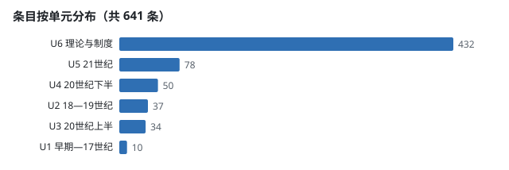
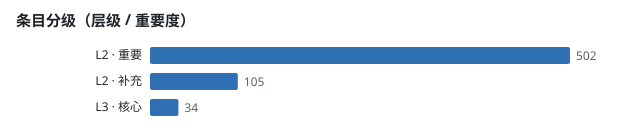
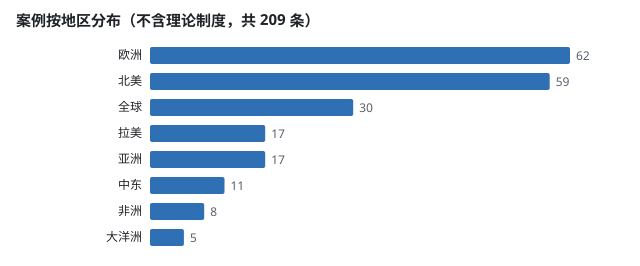
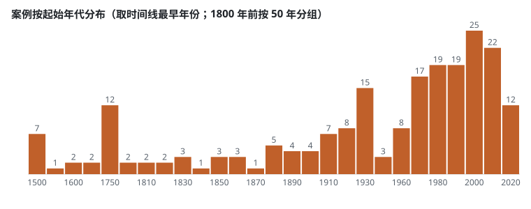
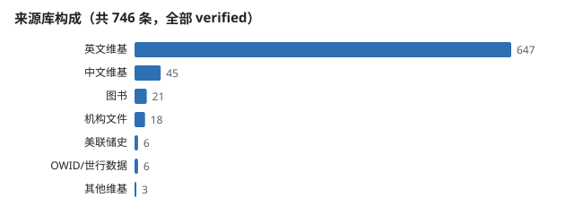

# 经济史与金融危机案例库

一个**数据驱动、机器校验、诚实标注**的静态知识库网站，按「时期 × 地区 × 危机类型」组织
**641 个**案例与理论制度条目（案例 209 / 概念 432）。全站纯静态 HTML + CSS，零 JavaScript、零图片，图表均为内联 SVG，支持浅色/深色双模式。

**在线访问**

- 网站首页（GitHub Pages 启用后）：<https://tiandihuang.github.io/jingji/>
- 统计可视化：<https://tiandihuang.github.io/jingji/docs/dashboard.html>
- 仓库地址：<https://github.com/TianDiHuAng/jingji>

## 当前规模

| 项 | 数值 |
|---|---|
| 条目 | **641**（案例 209 / 概念 432） |
| 来源库 | **746**（全部 verified） |
| key_data | **675** 条（按“本行 sources 少于 2 个”统一计数：649 条只有 1 个来源，页面明示“待核实”） |
| timeline 事件 | **1026** 条 |
| 站点页面 | **659**（18 静态页 + 641 条目页） |
| 概念→案例关联 | **442 条**（272/432 个概念条目至少 1 条案例链接） |

## 可视化

统计图表由 `python -X utf8 tools/gen_stats.py` 从 `data/` 自动生成（内联 SVG，浅/深双模式），完整总览见 [docs/dashboard.html](docs/dashboard.html)（部署后为 [在线统计总览](https://tiandihuang.github.io/jingji/docs/dashboard.html)）。









## 目录结构

```
.
├── scope.md              范围清单（权威大纲取并集）
├── coverage.json         覆盖数据（层级/单元/地区/类型/来源）
├── COVERAGE_MATRIX.md    覆盖矩阵（时期×类型、时期×地区、地区×类型 + 空白清单）
├── DECISIONS.md          无人值守决策记录
├── PROGRESS.md           进度与续跑起点（逐轮记录）
├── REPORT.md             项目摘要（当前规模/质量/遗留）
├── HEALTH_CHECK.md       体检报告
├── BACKLOG.md            待办与缺口
├── BLOCKERS.md           阻塞与质量问题记录
├── data/
│   ├── sources.json      来源库（746 条，逐条核对 verified）
│   └── entries/*.json    641 个条目（L2/L3）
├── tools/                校验、生成与统计工具（见下）
├── docs/
│   ├── dashboard.html    统计总览页（自动生成）
│   └── charts/*.svg      README 引用的统计图
├── site/
│   ├── index.html        首页
│   ├── style.css         浅/深双模式样式（CSS 变量）
│   ├── unit-*.html       单元页 ×6
│   ├── <id>.html         条目页 ×641
│   └── index-all / timeline / sources / matrix / verification / cases / concepts / chronology / policy-tools / bubble-stages / decisions 页
└── .github/workflows/pages.yml  GitHub Pages 自动部署
```

## 快速开始

```bash
# 1) 校验数据（0 error / 0 warning 为通过）
python -X utf8 tools/check.py

# 2) 由 data/entries/*.json 重新生成整个站点到 site/
python -X utf8 tools/gen_site.py

# 3) 生成 README 用的统计图与 docs/dashboard.html
python -X utf8 tools/gen_stats.py
```

## 数据格式

每个条目是一个独立 JSON 文件（`data/entries/<id>.json`），核心字段：

- `id` / `title` / `level` / `tier` / `unit` / `period` / `region` / `crisis_type`
- `one_line` / `overview`：一句话定义与条目概述
- `timeline[]`：按年份排序的事件，每条带 `sources`
- `causal_chain[]`：因果链节点，每节点带 `sources`
- `schools[]`：不同学派/解释的并列呈现，每条带 `sources`
- `key_data[]`：可核查的关键数据，含 `label` / `value` / `unit` / `year` / `note` / `sources`
- `policy_response[]`：政策应对记录（案例条目）
- `comparison` / `related`：结构性对比与相关条目（概念↔案例自动分组展示）
- `needs_verification` / `pending_notes`：待核实标记与说明

## 工具（tools/）

| 工具 | 作用 |
|---|---|
| `check.py` | 数据层校验 **R1–R30 + R4b/R12b**（类型/来源/嵌套来源/SVG/枚举词汇/内容字段/coverage 一致性等） |
| `gen_site.py` | 静态站点生成器（自动核验站内断链） |
| `check_links.py` | 站点终检（站内链接、SVG 合法、图片禁用） |
| `check_quality.py` | HTML 结构（标题层次/重复 id/meta/表格 th + 任意字面 `**`） |
| `check_kd.py` | `key_data` 数值能否对照来源全文（含「亿/万 ↔ billion/million」换算） |
| `check_body_num.py` | 正文（overview/one_line/comparison）数字溯源 |
| `check_polnum.py` | `policy_response` 数字核对 |
| `check_sources.py` | 来源可达性抽样（verified=true 是否真可达） |
| `check_docs.py` | 文档统计一致性（REPORT/PROGRESS/METRICS 与真实数据） |
| `check_filler.py` | 无信息量内容检测（模板套话/占位值/跨条目重复句/整段高度相似） |
| `check_pages.py` | 页面间数字一致性 + 站点完整性 + 矩阵合计校验 |
| `kdclass.py` | `key_data` 验证层级分类（被 gen_site 与 check_pages 共享） |
| `selftest.py` | 检查器自测：逐一注入已知错误，确认每个检查确实能捕获（**35 项**） |
| `gen_stats.py` | 生成 docs/ 下的统计图与总览页（只读 data/，不影响站点检查） |
| `find_val.py` | 全字段「同款数字」搜索：改任一处数字后列出所有出现位置（防漏改） |

## 校验原则

- **不编造**：不虚构数字、日期、人名、引文或出处；查不到的内容明确标注「待核实」。
- **双源规则**：关键数字需至少 2 个独立 verified 来源；单一来源数字标「单一来源待核实」。
- **争议并列**：学界存在分歧时并列呈现，不替读者下结论。
- **不做预测**：不提供经济预测或投资建议。
- **可核对**：所有 11 道检查 + 35 项自测均可在本地复现。

## 部署（GitHub Pages）

推送到 `main` 后，GitHub Actions 工作流 `.github/workflows/pages.yml` 会自动：

1. 检出仓库；
2. 把 `site/` 与 `docs/` 组装为静态产物；
3. 将产物推送到 `gh-pages` 分支（每次推送覆盖）。

首次启用（GitHub 要求仓库管理员在网页端操作一次）：

1. 打开仓库 **Settings → Pages**；
2. **Build and deployment → Source** 选择 **Deploy from a branch**；
3. 分支选 **`gh-pages`**，目录选 **`/ (root)`**，保存。

保存后 GitHub 会从 `gh-pages` 分支发布站点，地址为 <https://tiandihuang.github.io/jingji/>；之后每次推送 `main` 都会自动更新该分支。

## 设计原则

- **数据驱动**：改 JSON 重跑生成器即可，不手改 HTML。
- **机器校验强制诚实**：双源规则、待核实、争议并列由检查器拒绝坏数据。
- **零依赖**：纯静态 HTML + CSS，无 JS、无图片，图示全为内联 SVG。
- **可复现**：数据、生成器、检查器与自测全部在仓库内。

## 已知遗留

- `hainan-property-bubble-1992`、`taiwan-bubble` 没有英文维基专题页，缓存停用，内容待补中文或其他来源。
- 约 160 个偏抽象/机构类概念条目暂无合适的案例关联（映射表见 `_research/related/README.md`）。
- 单一来源的 `key_data` 均已标「单一来源待核实」，尚未取得第二个独立来源。
- 详见 [`BLOCKERS.md`](BLOCKERS.md) 与 [`BACKLOG.md`](BACKLOG.md)。
